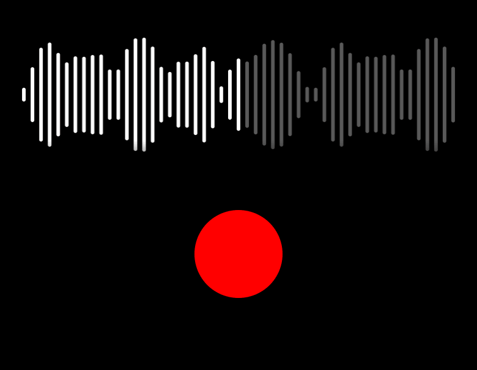
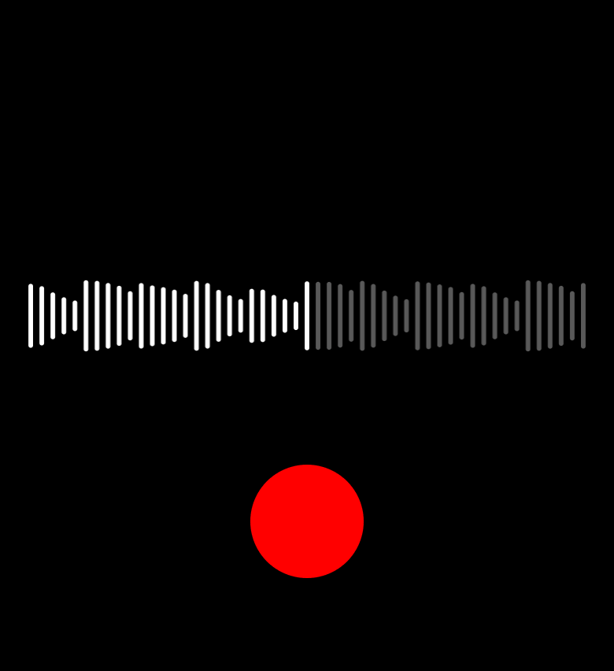
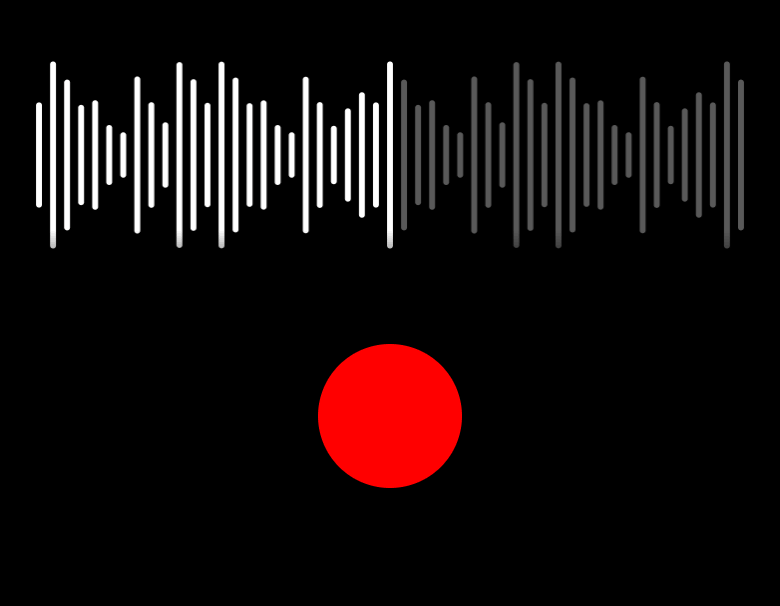
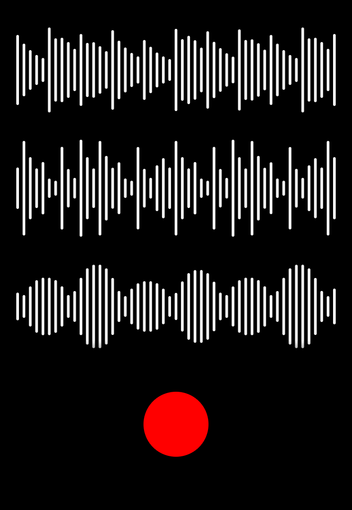
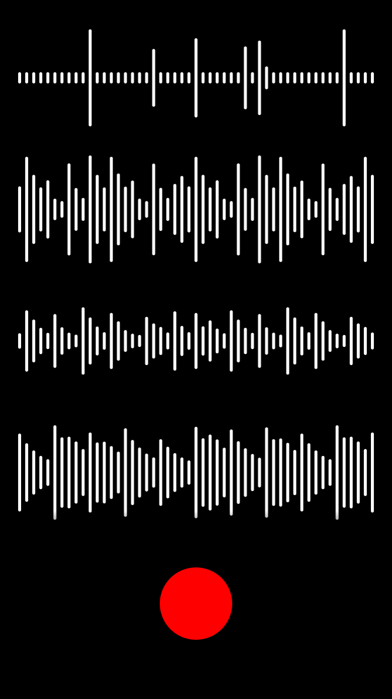

# soundstone

### lay down a track.

### play it back.

### play it loud.

### wow and flutter.

### scratch that.

### take it from the top.

### home recording.

try soundstone <a href="https://hunterirving.github.io/soundstone">in your web browser</a>, or install it as a <a href="https://hunterirving.github.io/web_workshop/pages/pwa">progressive web app</a>.